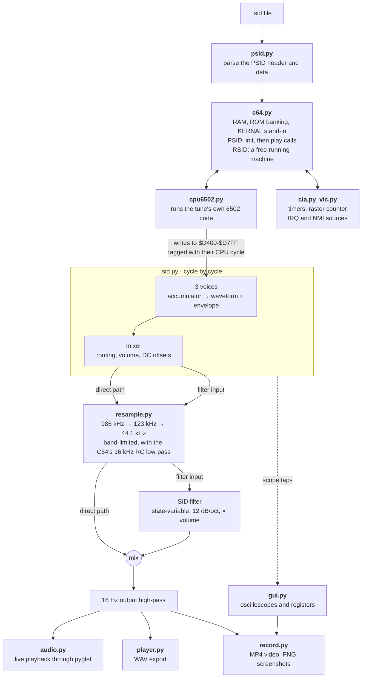

# numsid

A Commodore 64 SID music player written in Python. The MOS 6502 CPU runs the
tune's own player code, and the MOS 6581/8580 SID chip is synthesised
cycle by cycle with numpy. No SID or C64 emulation libraries are used, only
`numpy` for the maths and `pyglet` for audio output and the window.

[](https://www.youtube.com/watch?v=QAMZvv-m03c)

▶ [Watch numsid play the whole Commando main theme on YouTube](https://www.youtube.com/watch?v=QAMZvv-m03c)
(rendered with `--video`).

```
python -m numsid sids/Commando.sid
```


Playback is real time. Rendering Commando costs about 0.13 s of CPU per second
of audio offline, and about 25–40% of one core during live playback with the
visualiser open.

## Setup

```bash
uv venv .venv && uv pip install --python .venv/bin/python -e '.[test]'
```

(or `python -m venv .venv && .venv/bin/pip install -e '.[test]'`)

SID tunes are not included in this repository. Get `Commando.sid` (Rob Hubbard,
1985) from the [High Voltage SID Collection](https://www.hvsc.c64.org/), under
`MUSICIANS/H/Hubbard_Rob/`, and put it in `sids/`. Any other PSID file works
the same way. Tests that need the tune are skipped when it is missing.

## Usage

```bash
.venv/bin/python -m numsid sids/Commando.sid                 # window + live audio
.venv/bin/python -m numsid sids/Commando.sid --song 2        # pick a subtune
.venv/bin/python -m numsid sids/Commando.sid --headless      # audio only, Ctrl-C stops
.venv/bin/python -m numsid sids/Commando.sid --wav commando.wav --seconds 240
.venv/bin/python -m numsid sids/Commando.sid --model 8580 --no-filter --gain 1.5
.venv/bin/python -m numsid sids/Commando.sid --model 8580 --no-digiboost  # authentic C64C samples
.venv/bin/python -m numsid sids/Commando.sid --info          # header only
```

Window keys: `←/→` subtune, `1 2 3` mute a voice, `SPACE` pause, `F` filter
on/off, `M` switch between 6581 and 8580, `ESC` quit. A muted voice keeps its
scope, drawn in gray, and loses its envelope meter. Scopes and register
readouts follow what you are *hearing*: the emulator runs ahead of the sound
card, and the display looks up the state for the current playback position.


### Videos and screenshots

```bash
.venv/bin/python -m numsid sids/Commando.sid --video commando.mp4     # 1080p60 MP4
.venv/bin/python -m numsid sids/Commando.sid --screenshot shot.png --at 52
```

`--video` renders the visualiser offline on a fixed 60 fps timeline into an
offscreen 4× multisampled framebuffer. The emulator's own audio for that
timeline is encoded with it, so sync is exact and no frames drop. By default
it detects where the song's notes start repeating, records one full loop, and
fades out over the restart (Commando's main theme loops after 3:55.6). A
jingle that simply stops is recorded until its last note has died away. Use
`--seconds`, `--fps`, `--size 2560x1440` and `--fade` to override, and
`--mute 1,3` to silence voices. It needs `ffmpeg` on the PATH and encodes
H.264 + AAC (BT.709), ready for YouTube.

## How it works



* **CPU (`cpu6502.py`)**: every documented 6502 opcode plus the common
  "illegal" ones, NMOS decimal mode, cycle counts including page-crossing and
  branch penalties. Each opcode is a generated Python closure with its
  addressing mode inlined. Commando's player costs under 10 ms of Python per
  second of music.
* **Machine (`c64.py`, `cia.py`, `vic.py`, `kernal.py`)**:
  * **PSID tunes:** init is called once and play every frame, or on every
    CIA 1 timer A underflow for CIA-timed songs. The timer model follows the
    latch, force-load and stop/start writes a play routine makes.
  * **RSID tunes:** the CPU runs continuously, and the tune's own interrupts
    drive it: CIA timer IRQs, CIA 2 NMIs (sampled drums) and VIC
    raster-compare IRQs. Each is entered through the real vectors at the
    cycle it fires. Idle loops like `JMP *` are skipped.
  * **KERNAL:** a small replacement for the KERNAL ROM (the Commodore ROMs
    can't be shipped) provides the interrupt entry points and handlers, the
    jiffy clock, and harmless stand-ins for everything else.
  * **Banking:** the KERNAL and I/O are banked through `$01` like the real
    PLA, and writes reach the RAM underneath.
* **Timing**: register writes carry their cycle timestamp, and the SID splits
  each voice's timeline exactly there. Gate toggles within a frame, the ADSR
  delay bug, and sync and ring-mod phase relationships therefore come out as
  on hardware.
* **Oscillators**: 24-bit phase accumulators computed for every cycle with
  numpy, with hard sync (including the "source synced on the same cycle"
  rule), ring modulation and the test bit. Noise is the real 23-bit LFSR,
  clocked by accumulator bit 19. Its whole 8,388,607-step period is
  precomputed in ~0.1 s using the identity b[n] = b[n−23·2ᵏ] ⊕ b[n−18·2ᵏ].
* **Envelope**: the full reSID-style state machine: 15-bit rate counter with
  wrap-around, exponential decay divider with its thresholds, sustain
  equality comparator, freeze at zero, and the 0xFF→0x00 flip. Instead of
  ticking every cycle, it jumps from one counter step to the next and
  expands the steps to per-cycle values.
* **Combined waveforms**: a pull-down model (wired-AND plus neighbour-bit
  leakage) with the parameters fitted by the libsidplayfp project.
* **Mixer and filter**: per-voice routing, voice-3-off, and volume applied per
  cycle, so `$D418` sample playback works. The 6581 DC offsets are modelled.
  On the 8580, which has almost no offset (such samples are nearly silent on
  a real C64C), a sidplayfp-style "digi boost" is on by default.
  Cutoff curves come from measurements of real 6581 and 8580 chips.
* **Output**: a two-stage polyphase resampler (Kaiser windowed sinc,
  ≥80 dB alias rejection, flat to 19 kHz) with the C64's ~16 kHz RC low-pass
  folded into its kernel, then the 16 Hz coupling high-pass.

Chip behaviour follows reSID 0.16 (Dag Lem), the reference for SID emulation,
as described in its documentation and comments. All code here is new.

## Tests

```bash
.venv/bin/python -m pytest -q
```

`tests/reference_sid.py` is a deliberately naive cycle-by-cycle model of the
oscillators, sync, ring modulation and envelopes. The vectorised engine is
checked against it cycle for cycle on random register sequences, and must
match exactly. Other tests cover the CPU (arithmetic, decimal mode, flags,
page-wrap bug, illegal opcodes, cycle counts), pitch accuracy, LFSR output,
filter modes, determinism, chunk-size independence, and all 19 Commando
subtunes.

## Limitations

[ISSUES.md](ISSUES.md) has the full list of known bugs and missing features,
with a compatibility table for the HVSC Top 100: all 100 now play, RSID files
included.

* No sprite DMA: RSID tunes lose the bad-line cycles the VIC steals, but
  not the few extra cycles taken while sprites are shown.
* No BASIC or character ROM, and only a stand-in KERNAL. Tunes that call
  real ROM routines get a harmless return.
* One SID chip (no 2SID/3SID tunes).
* The filter is linear: no 6581 distortion or chip-to-chip variation, and
  reSID 0.16's mild resonance range.
* The noise LFSR "write-back" when noise is combined with other waveforms is
  not modelled; that combination produces an AND, near silence.
