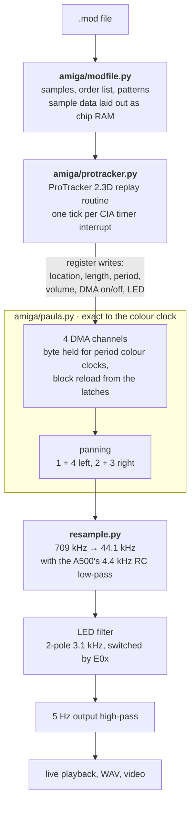

# Amiga MOD playback

How `numsid/amiga/` turns a `.mod` file into sound. See
[architecture.md](architecture.md) for how the packages fit together.

* **Replayer (`amiga/protracker.py`)**: ProTracker 2.3D's routine, which most MODs
  were written for. It runs as a CIA interrupt (`1773447 / BPM` timer
  cycles, 50 Hz at 125 BPM), reads a row every `speed` ticks, and runs the
  effects in between. It writes Paula's registers the way the 68000 code
  does, and keeps its quirks:
  * sample offset (`9xx`) is applied twice, so retriggers start further in,
  * arpeggio on a finetune −1 sample reads past the period table,
  * the tremolo's ramp waveform looks at the vibrato position,
  * a BPM change takes effect one tick late, when the CIA timer reloads,
  * an instrument without a note swaps the sample in when the playing one
    ends,
  * `EFx` inverts sample bytes in memory as they play.

  The behaviour follows 8bitbubsy's [pt2-clone](https://github.com/8bitbubsy/pt2-clone),
  a faithful port of the original code. The period, vibrato and funk tables
  come from it too.
* **Paula (`amiga/paula.py`)**: each channel plays its block from chip RAM, a byte
  per `period` colour clocks (3,546,895 Hz, PAL), and reloads the location
  and length latches when the block ends. That is how loops work, and how a
  sample swap happens. Period and volume take effect from the next byte.
  The output is rendered at the E clock (colour clock / 5), and every value
  is the exact average of the staircase over its five colour clocks,
  computed in integers. A naive colour-clock-stepped model checks it. The
  steps are kept as Paula makes them, so the images they produce around
  multiples of each sample's playback rate (the Amiga's crispness) are
  damped only by the analogue filters.
* **Output stage**: the A500's 360 Ω / 0.1 µF low-pass (4.4 kHz), or the
  A1200's 34 kHz one, is folded into the resampler's kernel, as the C64's RC
  filter is for the SID. The LED filter (Sallen-Key, 3.09 kHz, Q 0.66) runs
  at the output rate as a block-wise state-space IIR, so numpy does the
  work. It runs all the time, and `E0x` only switches its output in, so
  toggling it doesn't click. Component values are from the A500 and A1200
  schematics, as collected by pt2-clone.

## Known gaps

* PAL timing only.
* Every module plays with ProTracker 2.3D semantics, including multichannel
  ones written in PC trackers.
* Only one real module has been checked end to end so far (see
  [ISSUES.md](../ISSUES.md), M1).
