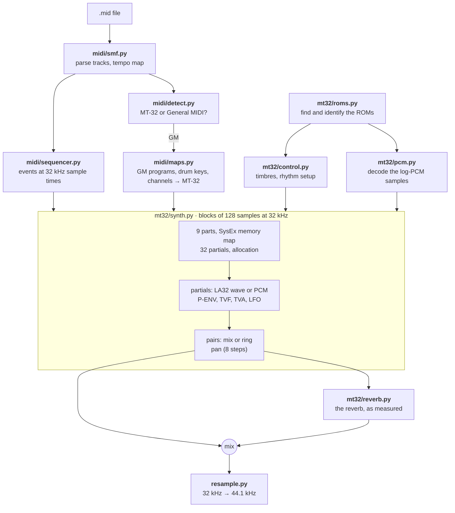
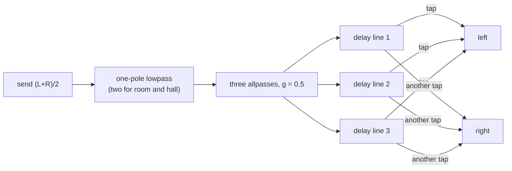

# MIDI files on the MT-32

How `numsid/midi/` and `numsid/mt32/` turn a MIDI file into sound. See
[architecture.md](architecture.md) for how the packages fit together and
[midi-plan.md](midi-plan.md) for the plan and what is still to come.

## The ROMs

The control ROM holds the factory timbres, the rhythm setup and the PCM
wave table; the PCM ROM holds the samples. Their layouts were worked out
from the images themselves and are described in the docstrings of
`control.py` and `pcm.py`. In short: timbres are the 246-byte SysEx timbre
format (14 common bytes, 58 per partial), stored fixed on the 1.x
firmware and packed on 2.x and the CM-32L; samples are 16-bit words of a
sign and a 14-bit log magnitude at 16 steps an octave.

## How the LA32 was measured

The MT-32's owner's manual documents what the 58 partial parameters are,
not what the LA32 chip does with them. The MT-32 engine is clean room (see
the plan), so the behaviour was measured: `tests`-style probe scripts send
a test timbre to Munt by SysEx (one partial, every parameter neutral but
the one under test), render it with `mt32emu-smf2wav`'s raw output
streams, and fit what comes out. Munt's source was not read. The same MIDI
files then play through numsid, so each finding can be checked against
the oracle, single notes first, then each channel of `theme.mid` alone,
then the whole mix.

What the measurements showed, and numsid now does:

**The TVF is not a filter.** A synth partial is a square wave whose edges
are half cosines. The cutoff sets how long an edge lasts: 8.4 samples at
100, 66 at 50 and 558 at 0, about an octave per 16.4 steps. Below the
half period the wave is a square with soft corners; once the edges would
be longer than the half period, the wave is a sine and its level falls
with about the square of the shortfall. The sawtooth is that square at
half the pitch (its edges twice as long) multiplied by a cosine at half
the pitch. A pulse width over 50 narrows the square (duty 0.5 × 2^(-(PW
- 50) / 25)); in a sawtooth that gives the half-pitch square even
harmonics, so the saw then repeats only every two periods, with
sub-harmonics, at about the same level. The PW velocity sensitivity is
strong: 100/256 PW steps per velocity step (from 64) per step of
sensitivity (from 7). Key follow moves the cutoff 15 steps an octave at a setting of
1, measured from middle C; the coarse pitch moves it as far as it moves
the pitch. The TVF envelope adds 0.67 × depth × level / 100 steps. The
TVF bias raises or lowers the cutoff for keys beyond the bias point.
`wavetable()` builds the wave from that description in the frequency
domain (each edge is a known spectrum), band-limited to the note.

**Resonance rings.** It lowers the square (to 0.52 at 30) and adds a
cosine after every edge, with a period of two edge lengths, swelling in
over the edge and dying away by a measured time. When the edges fill the
half period there is no ringing.

**Levels add in dB.**

| Parameter | Curve |
|-----------|-------|
| TVA level, part volume, expression (0-100) | one shared curve: 100 is 0 dB, 80 is -4.5, 50 is -14.3, 20 is -32.8 |
| Envelope level | 0.376 dB a step; 0 is silence |
| Velocity | 0.3 dB a step below 127 at sensitivity 100; 50 is no sensitivity, below 50 it works backwards |
| TVA bias | 0 to 36 dB an octave beyond the bias point |
| Pan | eight steps, and reversed: 0 is hard right; structures 8 and 9 spread their two partials apart |

**Envelopes.** A segment takes a fixed time whatever its distance, about
3.6 ms × 2^(T/8) (1 ms at 0, 0.28 s at 50, 1.5 s at 70). The release and
a fall to sustain level 0 are different: they keep going at their rate to
silence. Velocity follow shortens only the attack; time key follow only
the segments between attack and release.

**Pitch.** The P-ENV depth gives 100 × 2^(depth - 10) cents a step. The
LFO runs at 1.54 × 2^((rate - 50) / 8) Hz with 0.56 cents per step of
depth plus modulation. PCM playback steps are multiples of 1/1024.

**PCM partials** play at the same scale as synth ones, with no TVF.

**Drums** play at their key's pitch, so a timbre that follows the key
sounds higher on higher drum keys.

**Structures.** Ring modulation is the product of the two partials (each
at its own level); "ring" adds partial 1, "ring only" does not.

## The reverb

Measured the same way: test notes with the reverb set by SysEx, Munt's
reverb send (raw streams 2 and 3) and reverb output (streams 4 and 5),
and the impulse response solved for by least squares over several
differently panned recordings. It is linear and time invariant, and its
input is mono: the average of the two channels sent to it.

Deconvolving the response showed the network. Room, hall and plate share
one shape:

Each delay line feeds back on itself through a one-pole lowpass. The
delays differ by mode (room: allpasses 78, 729, 994; lines 2752, 2040,
3629 samples). The time setting only sets the feedback: 0.25, 0.45, 0.6,
0.75, 0.8, 0.85, 0.9, 0.95, the shortest line a little less at times 3-5.
Tap delay is a single line read at d for the left and 2d for the right,
d from 402 samples at time 0 to 8002 at time 7, feeding back with -0.69.
The level scales the output by 1, 2, 3, 4, 5, 7, 10 and 14 fourteenths
(tap delay has its own curve). Level 0 is not silent unless the time is 0
as well.

Fed Munt's own reverb send from `theme.mid`, numsid's reverb gives Munt's
reverb output to within 0.3-0.4% (about -48 dB) in room, hall and plate
and 1% in tap delay, at the same level.

## SysEx

Game soundtracks recorded from Sierra's MT-32 driver (Space Quest III,
Leisure Suit Larry) start with a bank of SysEx that rewrites most of the
memory map, and numsid follows it all:

| Address | What | numsid |
|---------|------|--------|
| 03 00 00 | patch temp, 16 bytes a part | timbre, key shift, fine tune, bend range, reverb switch, volume, pan |
| 03 01 10 | rhythm setup, 4 bytes a key from 24 | timbre (0-63 a memory timbre, 64 on the rhythm bank), level, pan, reverb |
| 04 00 00 | timbre temp, 246 bytes a part | the part's timbre |
| 05 00 00 | patch memory, 8 bytes a program | what native program changes select |
| 08 00 00 | timbre memory, 256 bytes a slot | timbre group 2, and drums |
| 10 00 00 | system | master tune, reverb mode / time / level, partial reserve, MIDI channel of each part, master volume |
| 20 00 00 | LCD | shown in the window |

## How close it is

Against Munt, reverb off (for the reverb, see above):

| Test | Result |
|------|--------|
| Levels and envelopes of test timbres | within 0.5 dB |
| PCM waves | sample for sample, residual -62 dB |
| 12 factory instruments, one note each | within 1-2 dB through attack, sustain and release |
| Drums | within 0.5 dB, same pan |
| Each channel of `theme.mid` alone | within 1.3 dB, octave bands within 2 dB |
| The whole of `theme.mid` | 0.4 dB louder, peak and loudness the same as Munt's |
| First 100 s of Space Quest III and Larry 1 (SysEx timbres) | -0.9 and +1.0 dB; each channel alone within about 2 dB |

Munt's raw output carries DC (narrow pulse waves are not centred); the
real MT-32's output is AC coupled and numsid's has none, so comparisons
take the DC out first.

## Not done yet

* Ring modulation with a PCM partial in the second slot does not match.
* The TVF envelope's reach grows above middle C in ways not modelled, and
  its velocity sensitivity parameter scales the depth whatever the
  velocity, which is copied as measured rather than understood.
* The LFO's shape is assumed to be a sine.
* The CM-32L's sound effects.
